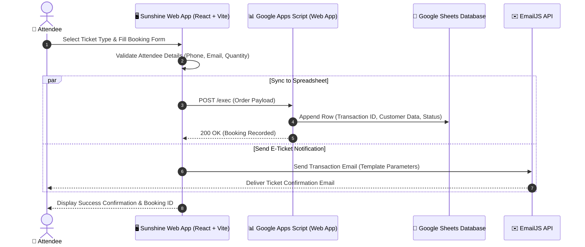

<div align="center">

# 🎭 SUNSHINE STUDIO
### Creative Theater Production & Ticketing Web Application

**Modern, High-Impact Event Portal with Interactive Seat Reservation & Ticketing Ingestion**

[](https://react.dev/)
[](https://vitejs.dev/)
[](https://www.emailjs.com/)
[](https://developers.google.com/apps-script)
[](LICENSE)

<br />

<p align="center">
  A bespoke, high-contrast black & yellow web experience designed for theater event promotions, cast showcases, and automated ticket ordering. Backed by Google Apps Script and EmailJS for zero-maintenance serverless transaction records.
</p>

[Key Features](#-key-features) •
[System Flow](#-transaction--booking-flow) •
[Tech Stack](#-tech-stack) •
[Getting Started](#-getting-started) •
[Environment Configuration](#-environment-configuration) •
[Project Structure](#-project-structure) •
[License](#-license)

</div>

---

## ✨ Key Features

- 🎭 **Curated Event Showcase**: Engaging hero section highlighting upcoming theater dates, venues, synopsis, and promotional trailer.
- 🎟️ **Interactive Ticket Reservation**: Step-by-step ticketing checkout with dynamic ticket category calculation and attendee info collection.
- ⚡ **Serverless Ingestion Pipeline**:
  - **Google Sheets API**: Direct sync of incoming ticket purchases to Google Sheets via Google Apps Script webhooks.
  - **EmailJS Confirmation**: Automated transactional receipt delivery to the buyer's email inbox.
- 👥 **Cast & Crew Directory**: Dedicated actor and production team spotlight with interactive member profiles.
- 📱 **Adaptive Responsive Design**: Tailored layout supporting seamless mobile navigation and fluid typography across all screen viewports.

---

## 🔄 Transaction & Booking Flow



---

## 🛠️ Tech Stack

| Category | Technology | Purpose |
|---|---|---|
| **Framework** | [React 18](https://react.dev/) | Component architecture & client-side routing |
| **Build Tool** | [Vite 5](https://vitejs.dev/) | Blazing fast HMR and optimized production bundling |
| **Routing** | [React Router DOM](https://reactrouter.com/) | Declarative client-side routing |
| **Form Processing** | EmailJS SDK | Client-to-email transactional dispatch |
| **Backend Storage** | Google Apps Script + Google Sheets | Zero-cost serverless database & admin sheet |
| **Deployment** | Vercel & Netlify Ready | Preconfigured `vercel.json` & `netlify.toml` |

---

## 🚀 Getting Started

### Prerequisites
* **Node.js**: `18.x` or higher
* **NPM**: `9.x` or higher

### Local Development Setup

1. **Clone the repository**:
   ```bash
   git clone git@github.com:muhamadjordysetiawan/sunshine-studio-website.git
   cd sunshine-studio-website
   ```

2. **Install project dependencies**:
   ```bash
   npm install
   ```

3. **Configure environment variables**:
   Create a `.env` file in the project root:
   ```env
   VITE_EMAILJS_SERVICE_ID=your_service_id
   VITE_EMAILJS_TEMPLATE_ID=your_template_id
   VITE_EMAILJS_PUBLIC_KEY=your_public_key
   VITE_GOOGLE_SCRIPT_URL=your_google_apps_script_web_app_url
   ```
   *(Refer to [`docs/guides/`](docs/guides/) for detailed Google Apps Script and EmailJS configuration guides).*

4. **Launch development server**:
   ```bash
   npm run dev
   ```
   Navigate to [http://localhost:5173](http://localhost:5173).

5. **Build for production**:
   ```bash
   npm run build
   ```

---

## 📂 Project Structure

```text
sunshine-studio-website/
├── docs/
│   └── guides/                 # Step-by-step setup guides for EmailJS & Google Sheets
├── public/                     # Static media assets and logos
├── src/
│   ├── components/             # Reusable UI elements (Navbar, Footer, TicketForm)
│   ├── pages/                  # Route views (Home, Tickets, About, Actors)
│   ├── styles/                 # Custom CSS stylesheets & design variables
│   └── App.jsx                 # Route declarations & root provider
├── google-apps-script.js       # Production Apps Script handler for Google Sheets
├── netlify.toml                # Netlify edge deployment configuration
├── vercel.json                 # Vercel SPA routing rewrites
├── vite.config.js              # Vite bundler options
└── package.json
```

---

## 📄 License

Distributed under the [MIT License](LICENSE).

---

<div align="center">
  Maintained with ☀️ by <b>Muhamad Jordy Setiawan</b>
</div>
